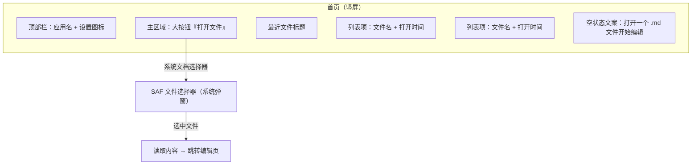
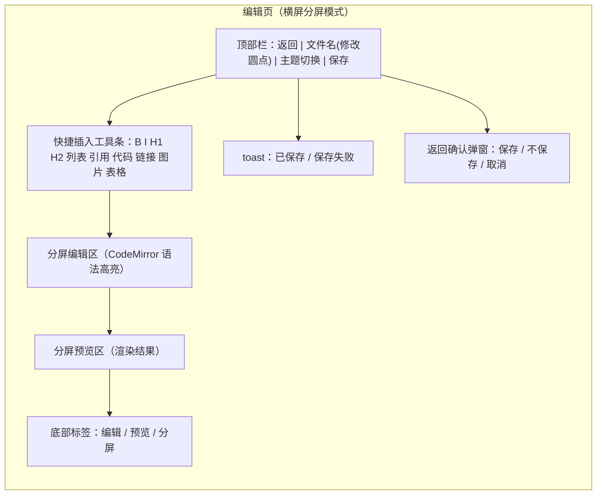
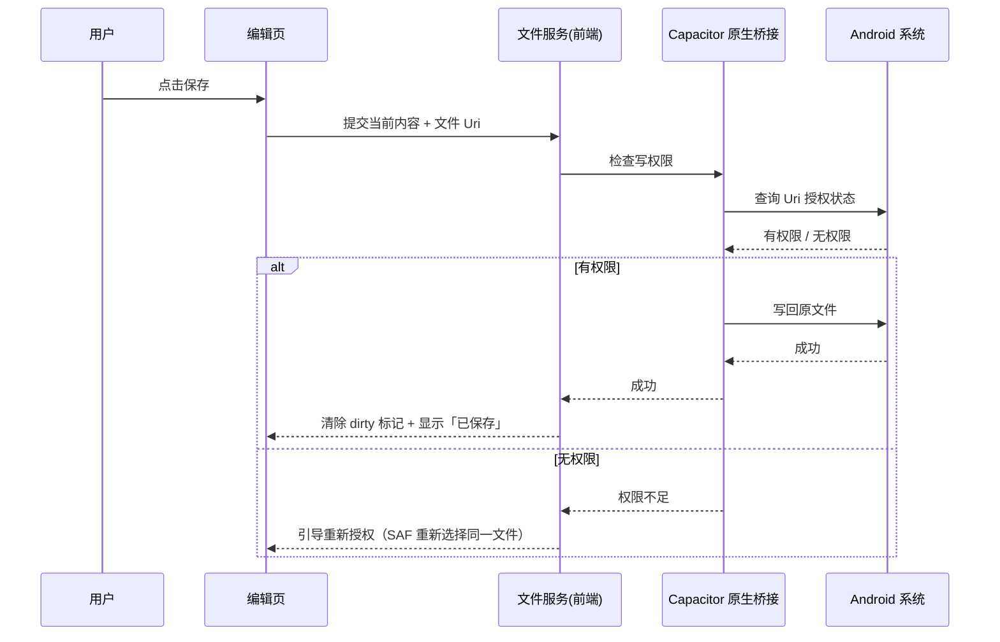
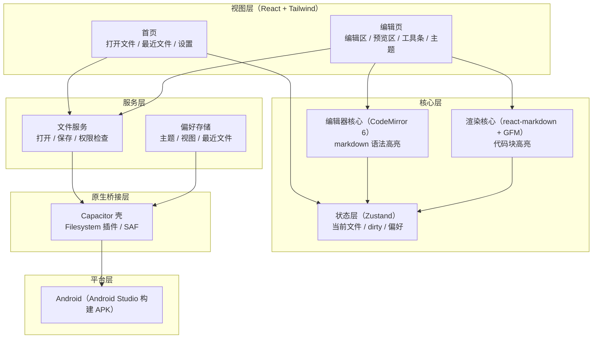

# 极简 Markdown 阅读与编辑器 · 项目开发文档

> 创建日期：2026-08-27
> 文档定位：需求说明 + 概要设计（面向开发实现）

## 一、需求背景

日常记录笔记、写作和技术文章时，Markdown 是最常用的纯文本格式。手机端现有的 Markdown 编辑 App 普遍存在两个问题：一是功能臃肿，打开即面对账号、云同步、模板商城等与写作无关的干扰；二是编辑与预览割裂，无法边写边看最终效果。

本项目的目标是做一个足够简单、专注本地的 Markdown 阅读与编辑器：打开手机上的任意 `.md` 文件，直接编辑，实时预览，保存回原文件。不引入账号体系、云同步和任何联网服务，数据全程留在本地。`[Expert judgment]`

## 二、产品目标

| 目标 | 成功标准 |
|---|---|
| 打开即用 | 从启动到进入编辑页不超过 3 秒，无需注册登录 |
| 所见即所得 | 编辑内容实时渲染到预览区，排版结果与最终展示一致 |
| 不丢内容 | 未保存修改有明确提示，任何路径下退出都不丢失用户输入 |
| 单文件闭环 | 打开、编辑、保存全流程都在同一个文件上完成，不产生副本 |
| 部署可交付 | 通过 Android Studio 构建出可安装的 APK，部署到真机验证通过 |

## 三、用户与场景

**核心用户**：本人。前端开发者，日常用 Markdown 记录笔记、写技术文档，习惯在手机上随时查看和修改 `.md` 文件。对编辑工具有一定要求：语法高亮、表格支持、代码块渲染要正确。

**使用场景**（按优先级排序）：

1. 在手机上打开文件管理器中的某个 `.md` 笔记，直接修改并保存回原位置。
2. 阅读别人发来的 Markdown 文件，切换到纯预览模式获得干净的阅读体验。
3. 碎片时间写作，利用快捷插入工具条在手机上快速录入标题、列表、引用、代码等语法。
4. 夜间环境下切换深色主题，保护眼睛。

**前置条件**：Android 系统，手机上存在 `.md` 文件。

## 四、竞品参考

首期不需要完整竞品分析，仅记录两类参考对象，用于校准功能取舍。`[To be supplemented - requires manual research]`

| 竞品类型 | 代表 | 可借鉴之处 | 我们要避免的 |
|---|---|---|---|
| 通用笔记 App | 备忘录、Notion | 简洁的编辑界面、清晰的排版 | 账号体系、云同步、功能堆砌 |
| 专业 Markdown App | 观想 Markdown、iA Writer | 语法高亮、专注模式、主题配色 | 付费墙、多端联动、复杂设置 |

结论：本产品只保留「打开、编辑、预览、保存、主题」五件事，其余一律不做。

## 五、功能需求

### 5.1 功能总览表

| # | 模块 | 功能描述 |
|---|---|---|
| F1 | 文件打开 | 首页点击「打开文件」唤起系统文档选择器，用户选中 `.md` 文件后，应用读取其文本内容并跳转到编辑页。打开失败（无权限、非文本文件、文件过大）时给出明确提示。 |
| F2 | 文件保存 | 编辑页点击「保存」将当前内容写回原文件。首次打开时若系统未授予持久写权限，则引导用户重新授权；授权失败时提示另存为其他文件。保存成功后清除「未保存」标记并短暂反馈。 |
| F3 | 未保存保护 | 内容发生修改后，进入「未保存」状态：标题栏文件名旁显示圆点标记；点击返回时弹窗确认「保存 / 不保存 / 取消」。防止误触丢失输入。 |
| F4 | Markdown 编辑 | 编辑区基于 CodeMirror 实现：支持 Markdown 语法高亮（标题、加粗、斜体、引用、代码、链接、列表）、行号、软换行。输入内容实时同步到状态层。 |
| F5 | 快捷插入工具条 | 编辑区上方提供横向滚动的工具条：加粗、斜体、标题、无序列表、有序列表、引用、行内代码、代码块、链接、图片、表格。点击后在光标处插入对应 Markdown 语法。解决手机键盘输入符号不便的问题。 |
| F6 | 实时预览 | 预览区使用 react-markdown 渲染，支持 GFM 扩展（表格、任务列表、删除线、自动链接）和代码块语法高亮。内容变化时预览即时刷新，刷新采用防抖（300ms）以保护大文件性能。 |
| F7 | 视图模式切换 | 支持三种视图：分屏（编辑 + 预览）、仅编辑、仅预览。手机窄屏下通过底部标签切换，竖屏默认仅编辑或仅预览，横屏自动进入分屏。 |
| F8 | 明暗双主题 | 主题三档可选：跟随系统、浅色、深色。切换即时生效，并持久化到本地。深色模式覆盖编辑区、预览区、代码块与工具栏的全部配色。 |
| F9 | 最近文件 | 本地记录最近打开过的文件（Uri 与文件名），首页展示最近列表，点击可直接重新打开，免去重复查找。 |
| F10 | 设置 | 提供主题、默认视图模式、正文字号三个设置项，全部持久化到本地。 |

### 5.2 模块详情与原型

#### 首页

功能描述：

- **F1 文件打开**：页面主区域是一个大尺寸「打开文件」按钮，点击后调用系统文档选择器（SAF）。选择器返回文件后，应用读取文本内容，记录最近文件，跳转编辑页。
- **F9 最近文件**：按钮下方展示最近打开的文件列表（名称 + 最近打开时间）。点击某项直接重新打开；长按可移除该项。列表为空时显示引导文案「打开一个 .md 文件开始编辑」。
- **F10 设置入口**：右上角齿轮图标进入设置弹层。
- **交互逻辑**：点击打开文件 → 系统选择器弹窗 → 选中文件 → 应用内加载（加载中转圈）→ 成功进入编辑页 / 失败提示原因。
- **边界与异常**：用户在选择器中取消，停留在首页，无任何提示；选择非 `.md` 后缀文件时仍允许打开（以内容解析为准），但提示「该文件可能不是 Markdown」；文件超过 2MB 时提示「文件较大，预览可能卡顿」。

**首页原型**：

#### 编辑页

功能描述：

- **F4 Markdown 编辑**：主体为 CodeMirror 编辑区，行号默认开启，Markdown 语法着色。
- **F6 实时预览**：分屏模式下编辑区与预览区各占一半，左右布局；窄屏（< 640px）退化为单屏，通过底部标签切换。
- **F5 快捷插入工具条**：编辑区顶部横向滚动条，包含 11 个插入按钮。点击后在光标处插入语法，并移动光标到内容占位处。插入后自动聚焦回编辑区。
- **F2 文件保存**：顶部栏右侧保存按钮。有未保存修改时按钮高亮。保存成功显示 1.5 秒的「已保存」toast。
- **F3 未保存保护**：内容 dirty 状态下，返回键/页面返回触发确认弹窗，三个选项对应保存、放弃、留在当前页。
- **F7 视图切换**：底部标签「编辑 / 预览 / 分屏」，当前模式高亮。横屏时自动切到分屏。
- **F8 明暗主题**：顶部栏主题切换图标（深色/浅色），点击在「跟随系统、浅色、深色」间循环，或弹出三选菜单。

**编辑页原型**：

**保存流程时序图**：

## 六、技术方案

### 6.1 总体架构

架构说明：视图层只负责界面与交互，编辑器核心与渲染核心是两套独立模块，通过状态层解耦——编辑区内容写入 Store，预览区从 Store 读取渲染，二者不直接通信。文件服务封装所有读写逻辑，屏蔽平台差异：在 Android 上走 Capacitor 原生桥接，在浏览器中走 File System Access API（作为开发期调试通道）。偏好存储只落本地，无任何网络请求。`[Expert judgment]`

### 6.2 技术选型及理由

| 技术 | 选型 | 理由 |
|---|---|---|
| 构建与框架 | Vite + React + TypeScript | 开发者的主力栈，Vite 启动与热更新快，TS 保证编辑器与渲染的数据契约稳定 |
| 编辑器 | CodeMirror 6（含 markdown 语言包） | 体积小、移动端触摸友好、Markdown 语法高亮开箱即用；Monaco 过于笨重，自绘 textarea 高亮方案维护成本高 |
| Markdown 渲染 | react-markdown + remark-gfm + rehype-highlight | React 生态标准组合，GFM 覆盖表格、任务列表、删除线，代码块高亮支持主流语言 |
| 状态管理 | Zustand | 轻量，无需 Provider 嵌套，适合单页小应用的全局状态 |
| 样式 | Tailwind CSS + CSS 变量 | 工具类快速搭界面，主题切换通过 CSS 变量一层穿透全部组件 |
| 移动壳 | Capacitor | 保留整套 Web 代码，生成 Android 原生工程后用 Android Studio 直接构建 APK；相比 TWA 有完整的原生文件访问插件 |
| 文件访问 | @capacitor/filesystem + 文档选择器桥接 | 读取/写入走原生层，通过 SAF 获得系统级文件选择与持久授权能力 |

Capacitor 与文件选择插件的具体版本、SAF 持久授权（`takePersistableUriPermission`）的封装方式在实现阶段确认。`[To be confirmed]`

### 6.3 模块设计

| 模块 | 职责 | 输入 | 输出 | 依赖 | 边界（不做什么） |
|---|---|---|---|---|---|
| 编辑器核心 | 提供带语法高亮的编辑区，产出纯文本内容 | 初始文本、光标位置 | 编辑后的文本、光标位置 | 状态层 | 不做拼写检查、不做自动补全的语法树 |
| 渲染核心 | 将 Markdown 文本渲染为可交互的 HTML 预览 | Markdown 字符串 | HTML 元素 | 状态层 | 不执行脚本，不加载外链资源 |
| 文件服务 | 封装文件的打开、保存、权限检查 | 文件 Uri、文本内容 | 成功/失败结果、错误码 | Capacitor 桥接 | 不管理目录结构，不做批量文件操作 |
| 偏好存储 | 读写主题、视图模式、字号、最近文件 | 键值数据 | 持久化结果 | Capacitor 桥接 | 不做多设备同步 |
| 状态层 | 持有当前文件、dirty 标记、偏好、toast 消息 | 各模块的写操作 | 全局可读状态 | 无 | 不包含业务逻辑，只做状态搬运 |

### 6.4 数据设计

**会话状态（内存，Zustand）**：

| 字段 | 类型 | 说明 |
|---|---|---|
| file | { uri, name, content } \| null | 当前打开的文件；uri 为空表示新建的空白文档 |
| dirty | boolean | 是否有未保存修改，初始 false |
| viewMode | 'edit' \| 'preview' \| 'split' | 当前视图模式 |
| theme | 'system' \| 'light' \| 'dark' | 主题选择 |
| fontSize | number | 正文与编辑器字号（px） |

**持久化数据（本地存储）**：

| 键 | 内容 | 说明 |
|---|---|---|
| settings | { theme, viewMode, fontSize } | 偏好设置，保存时整体写入 |
| recentFiles | [{ uri, name, openedAt }] | 最近文件列表，最多 10 条，按时间倒序 |

最近文件仅保存文件引用与名称，不缓存文件正文，避免内容陈旧误导用户。`[Expert judgment]`

### 6.5 非功能设计

- **性能**：冷启动目标 3 秒内进入可编辑状态；输入防抖 300ms 后刷新预览；文件大于 2MB 时给出提示并降低预览刷新频率。
- **离线**：所有资源随 APK 打包，应用运行不依赖网络，无任何在线依赖。
- **稳定性**：保存失败不覆盖用户内容——先写入成功后清 dirty，写入失败保留内容并提示重试。
- **可观测性**：首期不做埋点，预留一个极简的本地日志通道（写入应用私有目录），用于排查真机上的文件读写问题。

### 6.6 部署方案

1. 前端构建：`vite build` 产出静态资源。
2. Capacitor 同步：`npx cap sync android` 将资源与插件同步进 `android/` 工程。
3. Android Studio 打开 `android/` 目录，配置应用签名（debug 可直接装机），构建 APK。
4. 真机安装：USB 直连通过 Android Studio 部署，或导出 APK 手动安装。

## 七、迭代计划

| 阶段 | 内容 | 交付物 |
|---|---|---|
| M1 工程搭建 | Vite + React + TS + Tailwind 初始化；Capacitor 接入并生成 Android 工程 | 可在 Android Studio 构建的空壳 APK |
| M2 编辑与渲染 | 接入 CodeMirror、react-markdown + GFM + 代码高亮；打通状态层 | 浏览器中可编辑、可预览的完整双栏界面 |
| M3 文件读写 | 文件服务 + SAF 打开/保存 + 未保存保护 + 最近文件 | 真机上完成「打开→编辑→保存回原文件」闭环 |
| M4 主题与移动体验 | 明暗双主题、快捷插入工具条、视图切换、设置 | 移动端体验打磨完成 |
| M5 打包验证 | Android Studio 构建 APK，真机全流程回归 | 可安装交付的 APK + 验收通过 |

## 八、验收标准

| # | 验收项 | 通过条件 |
|---|---|---|
| 1 | GFM 渲染 | 打开含标题、表格、任务列表、代码块、图片引用的 `.md` 文件，预览区渲染结果正确 |
| 2 | 保存回原文件 | 修改后点保存，原文件路径不变、内容更新，系统文件管理器可确认 |
| 3 | 未保存保护 | 修改后不保存直接返回，弹窗确认，三种选择行为正确且不丢内容 |
| 4 | 语法高亮 | 编辑区标题、加粗、代码等语法有明显着色区分 |
| 5 | 主题切换 | 三档主题即时生效，编辑区、预览区、代码块配色全部正确，重启后记忆 |
| 6 | 启动性能 | 真机冷启动到可编辑状态 ≤ 3 秒 |
| 7 | 部署交付 | Android Studio 成功构建 APK，真机安装运行无崩溃 |

## 九、风险与待确认项

| 风险 / 待确认 | 影响 | 应对 |
|---|---|---|
| SAF 持久写权限在不同 Android 版本、国产 ROM 上表现不一致 | 保存可能失败 | 首期兼容策略：无权限时引导用户重新授权；保存失败保留内容并提示，不静默丢失 |
| Capacitor 与文件选择插件版本兼容性 | 构建或运行异常 | 实现阶段锁定版本组合后先在真机验证最小读写闭环（M3 前置） |
| 大文件渲染性能 | 预览卡顿 | 2MB 阈值提示 + 防抖降频；首期接受该边界，不引入分块渲染 |
| iOS 不在首期范围 | 无法在 iPhone 上使用 | 明确首期仅交付 Android；架构上文件服务已做平台隔离，后续可低成本扩展 |

> 以上标注 `[To be confirmed]`、`[Assumption]` 的内容需在 M1 启动前与开发者确认，其余按本设计执行。
